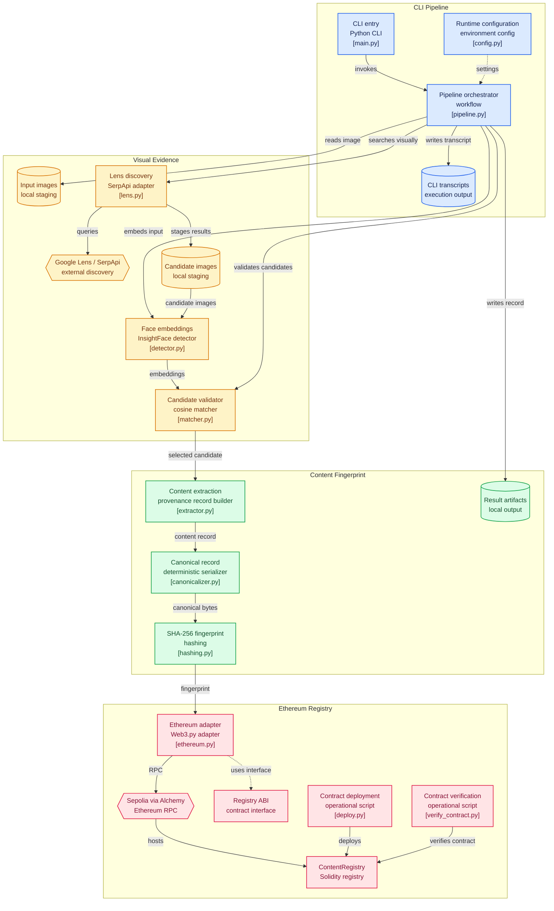

# TraceChain — AI-Powered Web Content Discovery & Blockchain Verification

<p align="center">
  <strong>Discover. Verify. Preserve Provenance.</strong>
  <br />
  An AI-powered pipeline for discovering visually matching web content and establishing tamper-evident digital provenance.
</p>

<p align="center">
  
  
  
  
  
  
  
</p>

<p align="center">
  
  
  
  
</p>

---

## Overview

**TraceChain** is an end-to-end AI and blockchain pipeline designed to discover, identify, and verify web content associated with a face-containing image.

The system accepts a local image as input, performs reverse-image discovery through Google Lens, retrieves visually similar candidate images, and applies facial recognition to identify matching content. Once a qualifying result is identified, TraceChain extracts relevant metadata, generates a deterministic cryptographic fingerprint, and registers that fingerprint on the Ethereum Sepolia blockchain.

By combining computer vision, reverse-image search, cryptographic hashing, and blockchain technology, TraceChain establishes a provenance-oriented workflow for discovering and maintaining verifiable references to digital content.

The system is designed around a modular pipeline in which each stage performs a distinct responsibility, from initial image processing to blockchain registration and subsequent verification.

### Project Objectives

- Discover publicly indexed web content associated with a given image.
- Apply facial recognition to distinguish relevant matches from visually similar search results.
- Extract and structure metadata from discovered content.
- Generate deterministic SHA-256 fingerprints for content records.
- Register cryptographic fingerprints on a blockchain.
- Provide a mechanism to verify whether a recorded content representation has changed.
- Demonstrate how AI-based discovery and decentralized verification can complement one another.

---

## Problem Statement

Digital images and online content frequently circulate across multiple platforms without reliable information about their original sources or subsequent modifications.

Visual content may be:

- Reposted across different websites and social-media platforms.
- Modified, cropped, or manipulated after its original publication.
- Shared without attribution or source information.
- Taken out of its original context.
- Difficult to trace back to its earliest discoverable online appearance.
- Presented without a verifiable record of its digital integrity.

Traditional reverse-image search tools help locate visually similar content, but they do not independently establish whether a discovered result depicts the same individual or provide a cryptographically verifiable record of the discovered content.

Similarly, conventional metadata-based tracking cannot reliably detect modifications to an image or its associated recorded representation.

TraceChain addresses these limitations by combining automated web discovery, facial matching, deterministic content fingerprinting, and blockchain-backed verification into a unified workflow.

---

## Proposed Solution

TraceChain implements a multi-stage processing pipeline that transforms an input image into a blockchain-verifiable content record.

### End-to-End Workflow

```text
                INPUT IMAGE
                     │
                     ▼
          ┌─────────────────────┐
          │ Face Detection      │
          │ + Face Embedding    │
          └──────────┬──────────┘
                     │
                     ▼
          ┌─────────────────────┐
          │ Google Lens Search  │
          │ via SerpApi         │
          └──────────┬──────────┘
                     │
                     ▼
             Candidate Results
                     │
                     ▼
          Candidate Image Download
                     │
                     ▼
          ┌─────────────────────┐
          │ Face Matching       │
          │ Cosine Similarity   │
          └──────────┬──────────┘
                     │
                     ▼
              Matching Content
                     │
                     ▼
           Metadata Extraction
                     │
                     ▼
          Deterministic Canonicalization
                     │
                     ▼
                SHA-256
                     │
                     ▼
          ┌─────────────────────┐
          │ Ethereum Sepolia    │
          │ ContentRegistry     │
          └──────────┬──────────┘
                     │
                     ▼
             Blockchain Record
                     │
                     ▼
               Re-verification
```

### Processing Stages

| Stage | Responsibility |
|---|---|
| Image Input | Accept a local image for processing |
| Face Detection | Detect faces and generate facial embeddings |
| Web Discovery | Search visually similar content using Google Lens |
| Candidate Retrieval | Collect candidate image URLs and associated metadata |
| Face Matching | Compare target and candidate facial embeddings |
| Content Extraction | Extract relevant source and content metadata |
| Canonicalization | Serialize the content record deterministically |
| Fingerprinting | Generate a SHA-256 cryptographic fingerprint |
| Blockchain Registration | Register the fingerprint on Ethereum Sepolia |
| Verification | Compare current content fingerprints against the registered record |

---

## System Architecture

TraceChain follows a modular, component-oriented architecture that separates image processing, web discovery, content extraction, cryptographic operations, and blockchain interaction.

The Python CLI acts as the entry point, while a centralized pipeline orchestrator coordinates the individual processing modules.

### Architecture Diagram



---

## Core Features

### 1. Face Detection & Recognition

TraceChain uses **InsightFace** with its `buffalo_l` model package to perform facial detection and embedding generation.

The facial recognition module provides the following capabilities:

- Detect faces within the input image.
- Generate numerical facial embeddings representing detected faces.
- Process candidate images retrieved through reverse-image search.
- Extract facial embeddings from accessible candidate images.
- Compare target and candidate embeddings using cosine similarity.

The generated embeddings are passed to the candidate matching module for similarity-based validation.

### 2. Reverse Image Discovery

TraceChain integrates **Google Lens through SerpApi** to discover visually similar content across indexed web sources.

Unlike a static lookup system, the application performs reverse-image discovery dynamically at runtime using the supplied input image.

The discovery process is:

```text
Input Image
     ↓
SerpApi
     ↓
Google Lens
     ↓
Visual Search Results
     ↓
Candidate URLs + Images
```

The search results are treated as candidate content rather than automatically accepted matches.

### 3. SerpApi Integration

TraceChain uses SerpApi's **Google Lens API** (`engine=google_lens`) for reverse-image search.

It does not use SerpApi's regular Google web-search service for the discovery pipeline.

The integration follows these steps:

1. Upload the local input image to SerpApi's image-upload endpoint:

   `https://serpapi.com/image`

2. Authenticate the request using `SERPAPI_KEY`.

3. Receive a temporary `image_id` associated with the uploaded image.

4. Submit a Google Lens request through the SerpApi Python client using:
   - `engine=google_lens`
   - `image_id`
   - `hl=en`

5. Retrieve the `visual_matches` returned by Google Lens.

6. Extract relevant information from each result, including:
   - Content title
   - Source URL
   - Thumbnail image URL
   - Original image URL, when available

7. Pass accessible candidate images to the facial recognition pipeline.

**Integration Boundary**

SerpApi is responsible exclusively for discovering visually similar web content.

The subsequent candidate validation, content extraction, fingerprint generation, and blockchain registration are handled by TraceChain.

A valid SerpApi account with Google Lens API access and a configured `SERPAPI_KEY` is required.

### 4. Face-Based Candidate Verification

Reverse-image search results are not considered verified matches by default.

TraceChain introduces an additional facial recognition stage to validate candidate images against the input image.

**Matching Workflow**

```text
Target Face
     │
     ▼
Face Embedding
     │
     │
     ▼
Candidate Face Embedding
     │
     ▼
Cosine Similarity
     │
     ▼
Similarity Score
     │
     ▼
Candidate Validation
```

Cosine similarity is used to measure the similarity between the target and candidate facial embeddings.

The highest qualifying result is selected as the matching candidate.

This additional validation stage helps distinguish relevant facial matches from unrelated results returned by visual search.

### 5. Content Extraction & Provenance Records

After identifying a qualifying candidate, TraceChain extracts the associated content information and constructs a structured provenance record.

The record can contain:

| Attribute | Description |
|---|---|
| Source URL | Location of the discovered content |
| Platform | Source platform or website |
| Title | Associated content title |
| Text / Metadata | Available descriptive information |
| Image SHA-256 | Cryptographic fingerprint of the image representation |

The extracted information is passed to the canonicalization module before hashing.

### 6. Deterministic Content Fingerprinting

TraceChain generates a cryptographic fingerprint of the structured content record using SHA-256.

Before hashing, the record is serialized through a deterministic canonicalization process.

This ensures that equivalent structured records produce a consistent serialized representation.

**Fingerprint Generation Pipeline**

```text
Content Metadata
      +
Image Fingerprint
      ↓
Canonical JSON
      ↓
SHA-256
      ↓
Content Fingerprint
```

The resulting fingerprint acts as a compact digital reference for subsequent blockchain registration and verification.

### 7. Blockchain Registration

TraceChain integrates with the Ethereum Sepolia testnet through Web3.py and an Alchemy RPC endpoint.

The generated content fingerprint is submitted to the deployed `ContentRegistry` smart contract.

The blockchain record contains information such as:

- Content fingerprint
- Source URL
- Registration timestamp
- Submitting wallet address

Instead of storing the original image directly on-chain, TraceChain stores compact verification information.

This reduces the amount of data written to the blockchain while retaining a verifiable reference to the registered content.

### 8. Blockchain-Based Verification

Once a fingerprint has been registered, TraceChain can verify whether a subsequently generated fingerprint matches the registered value.

If the content representation changes, its SHA-256 fingerprint will generally change as well.

The verification process compares the current fingerprint against the blockchain record.

A matching fingerprint indicates that the current representation matches the registered fingerprint.

A mismatch indicates that the current representation differs from the registered record.

---

## Blockchain Architecture

TraceChain uses Ethereum Sepolia as its blockchain environment for registration and verification.

### Blockchain Interaction Flow

```text
Python Application
        │
        ▼
     Web3.py
        │
        ▼
    Alchemy RPC
        │
        ▼
  Ethereum Sepolia
        │
        ▼
  ContentRegistry
        │
        ▼
Fingerprint Storage
        │
        ▼
On-chain Verification
```

### Why Blockchain?

Traditional local hashing can detect changes when the original fingerprint is available for comparison.

However, a locally stored hash can itself be modified or replaced if the storage environment is compromised.

Registering a fingerprint on a blockchain provides an externally verifiable reference that is more difficult to alter retrospectively.

TraceChain uses this property to establish a tamper-evident record of discovered content.

### Example: Content Modification

**Original Content**

```text
Original Content
       ↓
    SHA-256
       ↓
A6FB136AD91503...
       ↓
Ethereum Sepolia
```

**Modified Content**

```text
Modified Content
       ↓
    SHA-256
       ↓
73AC917BD712...
```

**Fingerprint Comparison**

```text
Blockchain:
A6FB136AD91503...

Current:
73AC917BD712...

VERIFICATION FAILED
```

When the content representation remains unchanged, the resulting fingerprint can be compared against the registered blockchain record.

---

## Smart Contract

TraceChain uses a Solidity smart contract named `ContentRegistry` to manage content fingerprint registration and verification.

The contract provides functionality for:

- Registering content fingerprints.
- Associating fingerprints with source URLs.
- Recording registration timestamps.
- Checking whether a fingerprint already exists.
- Emitting registration events.

### Contract Design

The contract intentionally stores compact verification metadata rather than complete image files.

This design separates the responsibilities of content discovery and storage from blockchain-based integrity verification.

| Component | Responsibility |
|---|---|
| Content Hash | Identifies the registered content representation |
| Source URL | References the discovered source |
| Timestamp | Records the registration time |
| Wallet Address | Identifies the submitting address |
| Contract Events | Expose registration activity |

---

## Technology Stack

TraceChain combines computer vision, external search infrastructure, cryptographic processing, and blockchain technologies.

| Category | Technology | Purpose |
|---|---|---|
| Programming Language | Python | Core application and pipeline orchestration |
| Face Recognition | InsightFace | Facial embedding generation |
| Face Detection | InsightFace | Face localization |
| Image Processing | OpenCV / Pillow | Image handling and preprocessing |
| Reverse Image Search | Google Lens | Visual web discovery |
| Search Integration | SerpApi | Google Lens API access |
| Similarity Measurement | Cosine Similarity | Facial embedding comparison |
| Cryptography | SHA-256 | Content fingerprint generation |
| Smart Contracts | Solidity | On-chain content registry |
| Blockchain | Ethereum Sepolia | Fingerprint registration |
| Blockchain Integration | Web3.py | Smart contract interaction |
| RPC Provider | Alchemy | Ethereum network connectivity |
| Wallet | MetaMask | Development wallet management |
| Interface | Python CLI | Pipeline execution and output |

---

## Security & Privacy Considerations

TraceChain combines facial recognition, web discovery, and blockchain registration. These capabilities require careful handling of images, credentials, and personal information.

### Credential Management

- Store API keys and private credentials in environment variables.
- Keep `.env` excluded from version control.
- Never expose wallet private keys through application logs or public repositories.
- Use a dedicated development wallet for testnet operations.

### Image Handling

- Process only images that are appropriately authorized for the intended use.
- Avoid distributing sensitive source images unnecessarily.
- Treat downloaded candidate images as external, untrusted content.

### Facial Recognition

Facial similarity scores are statistical measurements rather than absolute proof of identity.

Results can be affected by image quality, pose, lighting, occlusion, resolution, and other visual conditions.

### Blockchain Data

Information submitted to a public blockchain may be permanently accessible.

Only appropriate metadata and cryptographic fingerprints should be registered. Sensitive personal information and original images should not be placed directly on-chain.

---

## Local Development Setup

Follow these instructions to configure and run TraceChain locally.

### Prerequisites

Ensure the following tools and services are available:

- Python
- pip
- Git
- A SerpApi account with Google Lens API access
- An Alchemy account with Ethereum Sepolia RPC access
- A MetaMask development wallet
- Ethereum Sepolia testnet funds

### 1. Clone the Repository

```bash
git clone https://github.com/ritam-05/blockchain-image-tracing-computer-vision.git

cd blockchain-image-tracing-computer-vision
```

### 2. Create a Virtual Environment

```bash
python -m venv venv
```

Activate the environment.

**Windows**

```bash
venv\Scripts\activate
```

**Linux / macOS**

```bash
source venv/bin/activate
```

### 3. Install Dependencies

Install the required Python packages:

```bash
pip install -r requirements.txt
```

### 4. Configure Environment Variables

Create a `.env` file in the project root.

Add the following configuration:

```env
SERPAPI_KEY="your_serpapi_key"

WEB3_PROVIDER_URI="https://eth-sepolia.g.alchemy.com/v2/YOUR_ALCHEMY_API_KEY"

PRIVATE_KEY="your_wallet_private_key"

CONTRACT_ADDRESS="your_deployed_contract_address"
```

**Environment Variable Reference**

| Variable | Description |
|---|---|
| `SERPAPI_KEY` | API key for SerpApi Google Lens integration |
| `WEB3_PROVIDER_URI` | Ethereum Sepolia RPC endpoint |
| `PRIVATE_KEY` | Private key of the development wallet |
| `CONTRACT_ADDRESS` | Address of the deployed ContentRegistry contract |

**Important Security Notes**

- Replace all placeholder values with valid credentials.
- Use a dedicated development wallet containing only testnet funds.
- Never commit `.env` to GitHub.
- Keep private keys out of source code and execution logs.
- Use `.env.example` to document required configuration without exposing actual credentials.

### 5. Prepare the Input Image

Place the image you want to process inside:

```text
data/input/
```

For example:

```text
data/input/example.jpg
```

### 6. Run TraceChain

Execute the pipeline using:

```bash
python main.py data/input/example.jpg
```

The application will initiate the complete discovery, matching, fingerprinting, and blockchain workflow.

---

## Deployment & Smart Contract Configuration

TraceChain uses Ethereum Sepolia for its blockchain demonstration environment.

### Deployment Procedure

1. Configure the Alchemy Sepolia RPC endpoint.
2. Prepare a development wallet with Sepolia testnet funds.
3. Configure the wallet private key through `.env`.
4. Deploy the `ContentRegistry` contract using the deployment script.
5. Retrieve the deployed contract address.
6. Configure `CONTRACT_ADDRESS` in `.env`.
7. Ensure the corresponding contract ABI is available under `abi/ContentRegistry.json`.
8. Execute the contract verification script.

### Available Operational Scripts

| Script | Responsibility |
|---|---|
| `scripts/deploy.py` | Deploys the ContentRegistry smart contract |
| `scripts/verify_contract.py` | Performs contract verification |

### Deployment Dependencies

| Service | Responsibility |
|---|---|
| Ethereum Sepolia | Test blockchain network |
| Alchemy | RPC connectivity |
| MetaMask | Development wallet |
| Web3.py | Python-to-blockchain integration |

---

## CLI Execution & Output

TraceChain exposes a command-line interface for executing the complete pipeline.

### Execution

```bash
python main.py data/input/test.webp
```

Example:

```bash
python main.py data/input/example.jpg
```

### Example Execution Output

```text
==================================================
                  TRACECHAIN
==================================================

[1] FACE DETECTION
✓ Face detected

[2] FACE EMBEDDING
✓ Facial embedding generated

[3] WEB SEARCH
✓ Google Lens search completed
✓ 17 candidates discovered

[4] FACE MATCHING
Candidate 1: 0.34
Candidate 2: 0.71
Candidate 3: 0.89

✓ Matching content identified
Similarity: 0.89

[5] CONTENT EXTRACTION
✓ Metadata extracted

[6] CONTENT FINGERPRINT
✓ SHA-256 generated

Fingerprint:
a6fb136ad91503...

[7] BLOCKCHAIN REGISTRATION
Network: Ethereum Sepolia
✓ Transaction confirmed

Transaction:
0x...

[8] BLOCKCHAIN VERIFICATION
✓ Fingerprint found on-chain

==================================================
                 CONTENT VERIFIED
==================================================
```

---

## Output Artifacts

Each pipeline execution can generate a transcript and result artifacts for inspection.

The execution output is stored under:

```text
output/
```

Example:

```text
output/run_test.txt
```

### Recorded Information

The execution transcript can contain:

- Input image reference.
- Reverse-image search results.
- Number of discovered candidates.
- Candidate similarity scores.
- Selected matching source.
- Source URL.
- Image fingerprint.
- Canonical content fingerprint.
- Blockchain network.
- Smart contract address.
- Transaction hash.
- Final verification result.

These artifacts provide an execution-level record of the pipeline and its blockchain interaction.

---

## Repository Structure

TraceChain follows a modular Python package structure. Each module is responsible for a specific processing stage, making the application easier to maintain, test, and extend.

```text
tracechain/
│
├── README.md
├── USER_MANUAL.md
├── .env
├── .env.example
├── .gitignore
├── requirements.txt
├── main.py
├── config.py
│
├── src/
│   ├── __init__.py
│   │
│   ├── face/
│   │   ├── __init__.py
│   │   ├── detector.py
│   │   └── matcher.py
│   │
│   ├── search/
│   │   ├── __init__.py
│   │   └── lens.py
│   │
│   ├── content/
│   │   ├── __init__.py
│   │   ├── extractor.py
│   │   └── canonicalizer.py
│   │
│   ├── crypto/
│   │   ├── __init__.py
│   │   └── hashing.py
│   │
│   ├── blockchain/
│   │   ├── __init__.py
│   │   └── ethereum.py
│   │
│   └── pipeline.py
│
├── contracts/
│   └── ContentRegistry.sol
│
├── scripts/
│   ├── deploy.py
│   └── verify_contract.py
│
├── abi/
│   └── ContentRegistry.json
│
├── data/
│   ├── input/
│   ├── candidates/
│   └── results/
│
├── output/
│
└── tests/
    ├── test_face.py
    ├── test_hashing.py
    └── test_blockchain.py
```

### Module Responsibilities

| Module | Responsibility |
|---|---|
| `main.py` | CLI entry point |
| `config.py` | Runtime and environment configuration |
| `src/pipeline.py` | End-to-end workflow orchestration |
| `src/face/detector.py` | Face detection and embedding generation |
| `src/face/matcher.py` | Candidate face comparison |
| `src/search/lens.py` | Google Lens and SerpApi integration |
| `src/content/extractor.py` | Content metadata extraction |
| `src/content/canonicalizer.py` | Deterministic record serialization |
| `src/crypto/hashing.py` | SHA-256 fingerprint generation |
| `src/blockchain/ethereum.py` | Ethereum and smart contract interaction |
| `contracts/ContentRegistry.sol` | On-chain fingerprint registry |
| `scripts/deploy.py` | Smart contract deployment |
| `scripts/verify_contract.py` | Contract verification |
| `tests/` | Component-level test modules |

---

## Verification Demonstrations

TraceChain provides two primary demonstration scenarios to illustrate the discovery and verification workflow.

### Scenario 1 — Successful Content Verification

The first scenario demonstrates the complete pipeline using an input image and a qualifying web search result.

```text
Input Image
     ↓
Google Lens Discovery
     ↓
Candidate Retrieval
     ↓
Facial Recognition
     ↓
Candidate Validation
     ↓
Content Fingerprinting
     ↓
Ethereum Registration
     ↓
Blockchain Verification
     ↓
CONTENT VERIFIED
```

### Scenario 2 — Modified Content Detection

The second scenario demonstrates the effect of modifying a previously registered content representation.

```text
Registered Content
     ↓
Modify Content
     ↓
Recalculate SHA-256
     ↓
Retrieve Registered Fingerprint
     ↓
Fingerprint Comparison
     ↓
VERIFICATION FAILED
```

This scenario demonstrates the role of blockchain registration in maintaining a tamper-evident reference to the original fingerprint.

---

## What Blockchain Verification Actually Proves

Blockchain registration should not be interpreted as proof that the discovered content is authentic, truthful, or correctly attributed.

Instead, the blockchain provides a tamper-evident reference to a particular cryptographic fingerprint registered at a particular point in its history.

The distinction is important:

**Blockchain is not a truth detector.**

```text
Blockchain
     ≠
Truth Detector
```

**Blockchain provides a tamper-evident reference.**

```text
Blockchain
     =
Tamper-Evident Reference
```

TraceChain combines this property with web discovery and facial matching to establish a provenance-oriented workflow.

The system can demonstrate that a particular fingerprint was registered and whether a subsequently generated fingerprint matches that registered value. It cannot independently establish the original publication date, ownership, authenticity, or truthfulness of the discovered content.

---

## Known Limitations

### 1. Search Coverage

Google Lens results depend on the content indexed by the search provider. Not every image or website will produce a relevant result.

### 2. Platform Accessibility

Certain websites and social-media platforms restrict automated access to images, pages, and associated metadata.

### 3. Candidate Image Availability

Not all returned search results provide an accessible or downloadable image for further processing.

### 4. Facial Recognition Accuracy

Similarity measurements can be affected by:

- Image resolution and quality.
- Lighting conditions.
- Facial pose and orientation.
- Occlusion and partial visibility.
- Facial expression.
- Variations in image preprocessing.

A similarity score should not be interpreted as absolute proof of identity.

### 5. Metadata Variability

Web pages and associated metadata may change after discovery.

The fingerprint represents the canonicalized record generated during processing rather than guaranteeing that the source content or its metadata will remain unchanged.

### 6. Blockchain Environment

The current implementation uses Ethereum Sepolia for testing and demonstration.

It is not intended to represent a production-ready blockchain deployment.

---

## Future Enhancements

The modular architecture provides opportunities to expand TraceChain's discovery capabilities, verification mechanisms, and reporting infrastructure.

| Enhancement | Description |
|---|---|
| **Multi-Provider Reverse Search** | Integrate additional reverse-image search providers to improve discovery coverage. |
| **IPFS Integration** | Explore decentralized storage for content artifacts and provenance references. |
| **Extended Provenance Metadata** | Capture additional source information and content history. |
| **Confidence Calibration** | Improve the interpretation and calibration of facial similarity scores. |
| **Multi-Face Processing** | Extend the pipeline to handle multiple detected faces in a single image. |
| **Social Media Integrations** | Introduce additional authorized platform integrations for content discovery. |
| **Production Blockchain Deployment** | Explore deployment on a production blockchain environment. |
| **Decentralized Storage** | Investigate alternative storage architectures for long-term content references. |
| **Automated Provenance Reports** | Generate structured reports containing discovery and verification information. |
| **Browser-Based Visualization** | Introduce a graphical interface for inspecting results and blockchain records. |

---

## Project Summary

TraceChain brings together four major technology domains into a unified content discovery and verification pipeline.

| Technology Domain | Role in TraceChain |
|---|---|
| Computer Vision | Facial detection, embedding generation, and candidate matching |
| Web Discovery | Reverse-image search and candidate retrieval |
| Cryptography | Deterministic content fingerprinting using SHA-256 |
| Blockchain | Tamper-evident fingerprint registration and verification |

### End-to-End System

```text
Computer Vision
      +
Reverse Image Search
      +
Cryptographic Fingerprinting
      +
Blockchain Verification
      ↓
TraceChain
```

The resulting system can discover web content associated with a face-containing image, validate candidate content through facial embeddings, generate a deterministic cryptographic fingerprint, register that fingerprint on Ethereum Sepolia, and verify whether a subsequently generated fingerprint matches the registered record.

---

<p align="center">
  <strong>TraceChain</strong>
  <br />
  Discover. Verify. Preserve Provenance.
  <br /><br />
  <a href="https://github.com/ritam-05/blockchain-image-tracing-computer-vision">View Repository</a>
</p>
